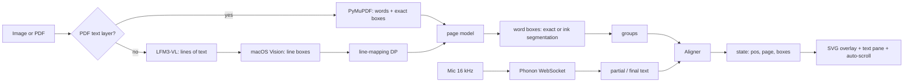

# Read Along — how it works

A detailed reference for the POC and for porting it to a native Mac app.

The short version: a page is turned into a list of words with boxes; a live speech
stream is matched against that list; the cursor moves; the UI draws boxes and
scrolls.

## Recent changes (2026-11-07)

- Visible name is **Read Along**; internal identifiers, bundle filename and
  data/log paths stay `ReadAlong` so existing installs keep working.
- First launch serves a `/setup` wizard: Welcome → Speech (158 MB) → Page
  reading (1.6 GB) → Ready. `GET /setup/status`, `POST /setup/download` and
  `POST /setup/finish` back it. Models are not in the DMG; speech lands in
  `~/.cache/fermion`, OCR in `~/.cache/huggingface` or `DATA/models/ocr`.
- OCR has an opt-in **Printed text (fast)** path: `POST /ocr {"fast":true}`,
  `--ocr-only --fast`, and the import quality selector use macOS Vision text
  and skip LFM3. Handwriting still uses LFM3 by default.
- Source images are capped at 2000 px before Vision/LFM3/segmentation.
- `Aligner` now indexes word positions and caches fuzzy scores; a partial
  update is ~0.2–0.4 ms instead of 19–26 ms.
- The reader only repaints spans/SVG when `pos`/group/boxes change; page turns
  use the HTTP cache.
- The bundle drops `datasets`, `pyarrow`, `pandas`, `cv2`, `onnxruntime` and
  `sympy`: app ~755 MB, DMG ~400 MB.
- `build_dmg.sh` builds in `/tmp` and retries `hdiutil create`; a synced
  Documents folder returned “Resource busy” for large images.
- The UI is the native SwiftUI shell in `macapp/` (NavigationSplitView, source
  list, `NSTextView` reading stage with temporary-attribute highlights,
  `Canvas` box overlay, AppKit player bar). There is no browser UI and no
  bundled HTML.
- First launch runs the last two (invisible) setup steps inside Settings and,
  when a scan needs OCR, in an inline model-setup card in the reader pane;
  there is no wizard page you must click through, and none of the
  "Welcome/Setup/Builder" routes are exposed.
- Narration uses `AVSpeechSynthesizer`; range callbacks, not timers, drive the
  cursor.
- Design-repair pass: restored the hidden Present overlay, removed the desktop
  navigation scrim, separated sidebar classes from the document title, stopped
  OCR job totals from overwriting word counts, centered Original/Split on the
  current highlight, and fixed the bundled sample path.
- Presentation-format pass: line boxes are ordered with recursive XY cuts so
  two-column pages read down one column before the next. Auto OCR now handles
  light-on-dark slides, keeps short printed labels, and uses macOS Vision for
  printed slide decks. Lines carry `block`, `kind`, and `sep` metadata so the UI
  renders headings, bullets, wrapped paragraphs, tags, and label/value rows.
  Cache version is 4; version 2 caches upgrade in place, version 3 (and older
  mapped pages) reprocess once — their LFM3 lines sat on one visual line's box,
  so words highlighted slivers ("ails,") instead of whole words.
- `map_lines` splits a merged OCR line across the stacked, unmatched Vision
  boxes it spans (word-level sequence alignment), so the reader text, the page
  overlay boxes and the highlights agree again on wrapped paragraphs.
- Reader visibility pass: dark-mode highlight now sets dark ink inside the
  amber wash, and Settings gains a reading-font picker (New York / SF Pro /
  SF Mono).



---

## 1. What the user sees

One page window, driven by one Python process:

- The app window: **Library** sidebar (source list with document rows),
  **Text / Original / Split** panes, and a bottom **reader bar**.
- **Read to me** uses an installed macOS voice; **Follow me** uses the live
  microphone pipeline. Both share one cursor and saved position.
- Each document has its own source, page images, cache, and saved position.
- Edit Text is a native sheet; Settings opens as the app's Preferences window.

The current phrase is amber in text and gets amber boxes on the original; the
next phrase is blue. Already-read words dim and the next four are underlined.
Clicking a word jumps the cursor. `[` / `]` or the arrow keys move one phrase.
Space toggles the selected mode. If the reader restarts a nearby line, or skips
ahead and starts a nearby line, the highlight snaps to it. When the cursor
crosses a PDF page, Original and Split follow the page change.

---

## 2. Repository layout

```
readalong/
  readalong.py        one file: OCR, model, aligner, speech, HTTP server, HTML
  test_align.py       assert-based checks for the aligner and model
  requirements.txt
  README.md
  ocr.jpg             the handwritten sample
  ocr.pdf             the 4-page text PDF sample
  ocr-higlighted.jpg  the original hand-drawn style reference (unused by the app)
  fermion_main.py     entry point for the bundled fermion CLI
  macapp/
    main.swift        native WKWebView shell, backend lifecycle, menus
    Info.plist        bundle identity, mic usage string, local-network ATS
    AppIcon.icns
  Makefile            make app / dmg / run / test / clean shortcuts
  scripts/
    build_app.sh      build ReadAlong.app (Python runtime + packages + binary)
    build_dmg.sh      build the distributable .dmg
    make_icon.py      regenerate the icon
    requirements.lock.txt
  data/               generated workspace (gitignored; dev only)
    current.jpg       image source, if the current document is an image
    current.pdf       PDF source, if the current document is a PDF
    pages/
      p000.jpg|png    rendered page images
      p001.png
      ...
    cache.json        version-3 document cache
    asr.log           speech server log
```

`data/` is disposable. Delete it and the app re-processes the source. The
installed `.app` uses `~/Library/Application Support/ReadAlong/` instead, set
through `READALONG_DATA`.

---

## 3. The data model

Everything downstream works on one JSON model. It is built by
`build_pages_model(pages)`.

```json
{
  "pages": [
    { "width": 1241, "height": 1754, "image": "p001.png" }
  ],
  "lines": [
    {
      "page": 1,
      "text": "The first 40 days after childbirth are an important period of physical and emotional",
      "box": [0.09, 0.24, 0.82, 0.02],
      "exact": true,
      "tokens": [
        { "text": "The", "norm": "the", "w": 95, "box": [0.09, 0.24, 0.02, 0.02] },
        { "text": "first", "norm": "first", "w": 96, "box": [0.12, 0.24, 0.03, 0.02] }
      ]
    }
  ],
  "words": [
    { "text": "The", "norm": "the", "page": 1, "line": 3, "box": [0.09, 0.24, 0.02, 0.02] }
  ],
  "groups": [
    { "page": 1, "start": 95, "end": 99 }
  ]
}
```

### Fields

- **page** — index into `pages`, 0-based.
- **width / height** — pixel dimensions of the rendered page image. The UI uses
  these as the SVG viewBox and multiplies normalized boxes by them.
- **image** — filename under `data/pages/`.
- **lines** — visual lines in layout-aware reading order, across all pages.
  `line` on a word is an index into this global array. Each line also carries
  presentation metadata: `block` (a readable paragraph/title/list group),
  `kind` (`title | label | bullet | row | body`), and `sep` (how it joins the
  previous line in the same block).
- **tokens** — every whitespace-separated display token on the line. A token
  with `norm == ""` (an arrow, a lone bullet, punctuation) is display-only and
  has `w == -1`.
- **w** — index into the global `words` array, or `-1`.
- **words** — only alignable tokens. These are what the speech aligner walks.
- **groups** — contiguous ranges of word indices, 4 words or a punctuation
  boundary, whichever comes first. Groups never span a line or a page. The UI
  highlights one group amber and the next blue.
- **exact** — true when word boxes came directly from a PDF text layer. If
  false, `attach_word_boxes()` runs the ink segmenter.

### Coordinates

All boxes are `[x, y, w, h]`, normalized 0..1, **top-left origin**, relative to
the page image. Different sources are converted on the way in:

| Source | Native coordinate | Conversion |
|---|---|---|
| macOS Vision | normalized, bottom-left | `y = 1 - y - h` |
| PyMuPDF | PDF points, top-left | divide by page width/height |
| Ink segmenter | pixels, top-left | divide by image width/height |

The UI multiplies by the current page's `width`/`height` to get SVG user units.
The export multiplies by the page image's pixel size.

### Why a global word index

The aligner, the state, click-to-jump, and the keyboard shortcuts all speak one
language: `pos` is an index into `model["words"]`. Pages and lines are metadata
on those words. Moving to a different page is just `pos` crossing a boundary;
the UI reads the group's `page` and swaps the image.

---

## 4. Document ingestion

`process_source(path)` chooses one of two paths.

### 4.1 PDF with a text layer (the fast path)

`pdf_pages(path)`:

1. Open with PyMuPDF.
2. For each page, render a PNG at **150 DPI** (`page.get_pixmap(dpi=150)`). An
   A4 page becomes about 1241×1754 px.
3. Read `page.get_text("words")`. Each entry is
   `(x0, y0, x1, y1, text, block_no, line_no, word_no)` in PDF points.
4. Group words by `(block, line)`.
5. Merge lines that sit on the same baseline (`|Δy| < 3` points) and are close
   horizontally (`gap < 25` points). Some PDFs put each word in its own block
   (a list item), and without this merge a single visual line becomes ten lines.
6. Sort each line's words by x, join with spaces, and union the boxes.
7. Drop a bare page number in the bottom 10% of the page.
8. Normalize the line box and every word box by the PDF page's point size.

The result is `[{text, box, word_boxes}]` per page. `build_pages_model` assigns
`word_boxes` directly to the tokens and marks the line `exact: true`.

**Measured:** the 4-page `ocr.pdf` processes in **~0.4 s** with no OCR model and
no Vision call.

**Native Mac equivalent:** PDFKit. `PDFPage.string` gives the text; split it into
words and use `PDFPage.selection(for: NSRange)` or
`PDFPage.characterBounds(at:)` to get the rects. Render with
`PDFPage.draw(with:to:)` or use a `PDFView`.

### 4.2 Image or scanned PDF (the OCR path)

`image_pages(path)` copies the image to `data/pages/p000.jpg`, then calls
`run_ocr(path)`. `pdf_pages` renders every page, collects the pages whose text
layer has fewer than 10 words, then calls `run_ocr_many(jobs)`. That loads
LFM3-VL **once** for the whole document instead of once per page; the OCR thread
reports `(done, total)` through `App.start_ocr`, which the import card and reader
show as "Reading page 3 of 20…". A single page still goes through `run_ocr`.

`run_ocr_many` has two independent halves per page:

#### A. Text — LFM3-VL

`ocr_lfm3(path)` loads `LiquidAI/LFM3-VL-2B-MLX-4bit` through `mlx-vlm`
(0.7.11 or newer, per the model card) and asks:

> Transcribe the text exactly as written, in natural visual reading order. If
> the page has columns, panels, sidebars, tables, or diagram labels, finish one
> column or panel from top to bottom before moving to the next; never read
> across a vertical gutter or join text from two columns onto one line. Read a
> full-width heading before the columns beneath it. Preserve each visual line as
> its own output line. Preserve spelling, punctuation, arrows, capitalization,
> and meaningful line breaks. Ignore faint show-through. Do not guess: write
> [illegible] for unreadable words. Output only the transcription.

Sampling: `temperature=0.1`, `top_p=1.0`, `top_k=50`, `min_p=0.0`,
`repetition_penalty=1.1`, `max_tokens=2048`, **thinking off**. Thinking produced
the same text and no speed benefit.

The model is deleted and the MLX cache cleared immediately after the call, so it
does not compete with the speech server.

If LFM3 fails and Vision produced lines, the app falls back to Vision's text.
If both fail, the OCR error is shown in the document's processing state.

**Measured:** 1.59 GB weights, ~4.7 s load when cached, **35–46 s** for the
handwritten sample on an M1 Pro. Accuracy was about 90% of words; **Edit text**
is the correction path.

#### B. Line geometry — macOS Vision

`vision_lines(path)` runs `VNRecognizeTextRequest` through PyObjC, first at
`.accurate`, then at `.fast` if accurate throws. It returns every observation
with its text, confidence, and normalized bottom-left box.

`usable_lines()` keeps observations that:

- are not in the bottom 8% of the page (`y >= 0.08`),
- are line-sized (`0.006 <= h <= 0.14`, retaining slide headings),
- are at least `w >= 0.03` wide (short printed labels such as “Service cost”
  must survive),
- have confidence `>= 0.3`,
- contain at least two alphanumerics.

It converts Vision's bottom-left boxes to top-left and returns
`reading_order(lines)`, a recursive XY-cut: a clear vertical gutter is read down
one side then the other; if a full-width heading blocks the cut, a horizontal
whitespace band separates it and the columns beneath are cut next. A leaf sorts
visual rows left-to-right, keeping a label and its value together.

`_looks_printed()` applies the same top-left conversion and detects ink polarity
from the crop median, so white/pink text on a dark slide is not mistaken for a
solid dark blob. The printed hint is still based on separate letter blobs, not
Vision confidence, because Vision is confidently wrong on cursive.

> **Known macOS issue:** the accurate Vision model occasionally fails with
> `CRImageReaderError.e5rtError(...)`. The fast model still returns boxes but its
> text on cursive is gibberish. The app retries fast for geometry; the OCR text
> still comes from LFM3. A reboot usually restores the accurate model. PDFs are
> unaffected.

#### C. Mapping OCR lines to Vision boxes

`map_lines(ocr_lines, vlines)` does a **monotonic sequence alignment**, not a
greedy best match. Greedy matching let one bad OCR line (a diagram label) steal
a box and shift every line after it.

- `sim[i][j]` = `difflib.SequenceMatcher` ratio of normalized texts.
- Match score = `sim - 0.20` if `sim >= 0.35`, otherwise `-1.0`.
- Skipping either sequence costs `0.15`.
- Traceback pairs each OCR line with at most one Vision line, in order.
- Unmatched OCR lines keep `box: None`; their text still appears, but they have
  no image highlight.

This is what drops the "heart → Agent Turn" diagram line while keeping the 13
real lines aligned.

### 4.3 Word boxes from ink

For any line without exact PDF boxes, `attach_word_boxes()` runs
`segment_line()` on the grayscale page image.

1. Crop the line box.
2. Ink mask: for light paper, `pixel < min(140, median - 20)` (the paper is
   ~190, the ink ~60–100, bleed-through ~170+). For dark slides, the polarity
   flips to `pixel > median + 28` so white/pink text becomes the ink.
3. Column projection; contiguous ink columns become **blobs**. Blobs narrower
   than 2 px are dropped; then narrower than 3 px if there are more than two.
4. Word spaces are the gaps clearly wider than the rest:
   `threshold = max(8, 0.4 * median(top K-1 gaps))`, where `K` is the number of
   words on the line.
5. Cut at every gap above the threshold. If this yields too many groups, merge
   the adjacent pair with the narrowest gap until there are `K`.
6. If it yields too few groups, the last group is split proportionally by
   character width. This handles a correction written below the end of a line
   (`30 secs` with `minutes` underneath).
7. `_text_band()` finds the densest horizontal run of ink and clips each word
   box vertically to that band plus 28% margin, so ascenders from the line below
   do not make every box tall.
8. Convert pixel boxes to normalized top-left.

Character widths used for the proportional split: narrow `i l I . , : ; ' ! |`
= 0.45, wide `m w M W` = 1.45, `f j r t` = 0.75, arrow = 1.2, everything else
1.0.

This is the heuristic part. On the handwritten sample it produced boxes like:

```
[Heartbeats] [times] [by] [default] [fires] [every] [30] [secs]
```

**Native Mac equivalent:** Vision does not expose word-level boxes. Either port
this projection code with Accelerate/vImage, or use Vision's line observations
and split them proportionally. A native app could also use `VNRecognizeTextRequest`
with `.accurate` and its line boxes, then the same ink segmenter on a
`CGImage`.

---

## 5. Speech

### 5.1 Model and server

`FermionResearch/Phonon-2.5-English`:

- 158 MB, Parakeet TDT derivative, CC-BY-4.0.
- ~4.82% average WER on the Open ASR Leaderboard's seven English sets.
- MLX on Apple Silicon; CPU on Intel/Linux/Windows.

The app runs `fermion serve phonon-2.5-en --port 8010` as a subprocess. If a
speech server is already healthy on 8010–8019, it reuses it. If the port is
taken by something else, it picks a free one.

`ensure()` polls `GET /health` until `kind == "speech"`, up to 120 s. The first
load after a reboot compiles shaders and takes 10–40 s.

### 5.2 The live WebSocket

`ws://127.0.0.1:<port>/v1/audio/stream`

1. Client sends a JSON text frame:
   `{"sample_rate": 16000, "format": "pcm_f32le"}`.
2. Client sends binary frames of raw mono PCM. Frame boundaries do not need to
   align to sample boundaries.
3. Server sends JSON text frames:
   - `{"type":"partial","text":"..."}` — the whole hypothesis for the in-flight
     phrase. Replaces the previous partial. First one after ~0.35 s, then about
     twice per second.
   - `{"type":"final","text":"...","segment":N}` — a finished segment after
     ~0.7 s of silence, or at the 30 s cap.
   - `{"type":"done","text":"..."}` — after `{"type":"end"}` or a close.
   - `{"type":"error","message":"..."}`.
4. One live stream at a time. A second gets an error and close code 1013.
5. 90 s without audio closes the stream.

### 5.3 Microphone

`sounddevice.RawInputStream`:

- 16 kHz, mono, `float32`, `blocksize=1600` (100 ms).
- The callback puts each chunk into a `queue.Queue` and computes RMS for the
  level meter.
- An asyncio task drains the queue and sends binary frames.
- The receive loop calls `App._on_text(text, final)` for partials and finals.

`_run()` owns the asyncio loop in a background thread. `stop()` closes the mic,
sets `running = False`, and schedules `ws.close()` on the loop. `shutdown()`
terminates the speech subprocess if the app spawned it.

### 5.4 Startup ordering

`main()` starts one background thread, `_startup`:

1. `app.load()` from cache, or `app.ocr_now()`.
2. Only then `app.asr.ensure()`.

The web server is already listening, so the library shell loads immediately
and show "Reading the page…" until the model is ready. Serializing OCR and ASR
keeps peak memory down on a 16 GB machine and avoids loading two model stacks at
once.

---

## 6. Alignment

This is the heart of the app. It is pure Python with no model and no
dependencies beyond `difflib`.

### 6.1 Normalization

`norm_token`:

- NFKC normalize, lowercase.
- Strip everything except letters, digits, apostrophes; then strip apostrophes.
- Map number words to digits (`nine` → `9`, `thirty` → `30`).
- A token that normalizes to `""` (arrow, lone punctuation) is not alignable.

Both the script and the ASR text go through this.

### 6.2 Local anchor — restart or skip nearby

`Aligner._anchor()` runs first on every update. It looks for the best nearby
start for the last up-to-14 ASR words.

- Window: **±400 words** around `pos` (about a page).
- For every candidate start, greedily align the ASR words:
  - For each ASR word, look for an exact match within the next 4 script words.
  - If found, count it exact and advance past it.
  - If not, allow one fuzzy match at the current position (`_score > 0`).
- The **first ASR word must match** (exact or fuzzy); candidates that skip it are
  rejected. This kills false anchors on common words.
- Require at least **4 exact words**.
- Score: `exact - 0.6 * (phrase_length - matched) - 0.005 * |start - pos|`.
  The distance term prefers the nearest occurrence.
- Commit if `|end - pos| >= 2` and `score >= 2.0`.

The anchor is what makes this work:

- Reader restarts a line above → the phrase matches behind `pos`, the anchor
  jumps back.
- Reader skips ahead and starts a line below → the phrase matches ahead, the
  anchor jumps forward.
- Normal reading → the phrase matches at `pos`, the anchor's end is within one
  word, so it does not trigger; the DP refines.

Examples (script words `w0..w39`):

| Situation | `pos` before | ASR | `pos` after |
|---|---:|---|---:|
| Normal | 20 | `w20 w21 w22 w23` | 24 |
| Restart above | 20 | `w14 w15 w16 w17` | 18 |
| Skip below | 20 | `w30 w31 w32 w33` | 34 |
| Far jump (final) | 0 | `w25 w26 w27 w28` | 29 |

On the PDF, a partial phrase from page 1 while `pos` was on page 3 moved back
~285 words and switched the page; a phrase from page 3 moved forward ~300 words.

### 6.3 Monotonic DP — normal reading

If the anchor does not commit, the app runs a dynamic-programming alignment over
a forward window:

- `lo = max(0, pos - 3)`
- `hi = len(words)` on a final, else `min(len, pos + 32)`

Scores:

| Transition | Score |
|---|---:|
| exact word | +1.0 |
| fuzzy word (`SequenceMatcher` ratio ≥ 0.62) | +0.3 |
| substitution | −0.4 |
| skip a script word | −0.10 |
| skip an ASR word | −0.50 |

The DP finds the best end position. Then it traces back to the **last exact
match** in that path:

- A fuzzy substitution is enough to keep reading, but not enough to move the
  cursor past a word the reader may not have said yet.
- `new_pos = lo + last_exact + 1`.

Commit rules:

- `new_pos > pos` (the anchor handles backward moves).
- On a partial, at least 2 ASR words.
- Confidence `best / n >= 0.15` (partial) or `0.25` (final).
- On a partial, no jump larger than 8 words.
- On a final, a jump larger than 6 words needs at least 3 ASR words.

Confidence is displayed as a percentage. It is `best / number_of_asr_words`,
clamped to 0..1.

### 6.4 Why not embeddings?

The problem is exact word tracking against a known script. A fuzzy monotonic DP
is deterministic, runs in microseconds, and needs no model. EmbeddingGemma 2
could help with semantic re-anchoring after heavy paraphrasing, but reading a
script aloud is not paraphrasing. The anchor already covers restarts and skips.
Adding a 270M–740M embedder would cost memory and latency for no accuracy gain.

### 6.5 State after alignment

`App.state()` turns `pos` into UI state:

- `current` = `[start, end)` of the group containing `pos`.
- `next` = the following group.
- `page` = the current group's page.
- `current_boxes` = union of the current group's word boxes, per line.
- `next_boxes` = union of the next group's boxes, **only if it is on the same
  page**. When the next phrase is on the following page, the blue box is empty
  and the page turns when the cursor gets there.

`group_at()` is a linear scan over the groups (there are tens, not thousands).
`group_boxes()` unions boxes per line so a group that spans two lines gets two
rounded rectangles.

---

## 7. The HTTP API

The server is Python's `ThreadingHTTPServer` on `127.0.0.1:8765` (or the next
free port). No auth; loopback only.

### GET

| Path | Returns |
|---|---|
| `/library` | document list, active id, processing progress |
| `/setup/status` | model download status JSON |
| `/sample` | the bundled sample PDF for the empty-library action |
| `/image` | active document page 0 (compatibility alias) |
| `/page/<i>` | active document page `i`, PNG or JPEG |
| `/model` | the active document model JSON |
| `/state` | the live state JSON (polled by the UI) |
| `/export?mode=read\|proof&page=N` | JPEG download |

### POST (JSON bodies)

| Path | Body | Effect |
|---|---|---|
| `/documents/import` | `{"name":"x.pdf","data":"data:...;base64,...","mode":"auto"}` | create a document workspace and start OCR |
| `/documents/open` | `{"id":"..."}` | stop current playback, open and restore a document |
| `/documents/rename` | `{"id":"...","title":"..."}` | rename a library document |
| `/documents/delete` | `{"id":"..."}` | delete a managed workspace; refuse while OCR runs |
| `/upload` | `{"name":"x.pdf","data":"data:..."}` | compatibility wrapper for `/documents/import` |
| `/ocr` | `{}` / `{"fast":true}` / `{"auto":true}` | process the active document |
| `/setup/download` | `{"model":"speech"\|"ocr"}` | start a background model download |
| `/setup/finish` | `{}` | mark onboarding done |
| `/script` | `{"page":0,"text":"line\nline"}` | replace one page's text, rebuild, reset aligner |
| `/start` | `{}` | start the mic and WebSocket |
| `/stop` | `{}` | stop the mic and stream |
| `/jump` | `{"word":123}` | set `pos` directly and persist it |
| `/simulate` | `{"text":"...","final":true}` | feed a transcript without a mic (testing) |

### State JSON

```json
{
  "doc_id": "f5c310d766f74f17b582490550d80a53",
  "status": "idle | loading | listening | error",
  "error": "",
  "partial": "the last ASR hypothesis",
  "rms": 0.021,
  "ocr_status": "idle | running | done | error",
  "ocr_error": "",
  "model_ready": true,
  "pos": 95,
  "total": 995,
  "current": [95, 99],
  "next": [99, 103],
  "page": 1,
  "next_page": 1,
  "current_boxes": [[0.09, 0.24, 0.82, 0.02]],
  "next_boxes": [[0.09, 0.27, 0.60, 0.02]],
  "confidence": 0.93
}
```

`status` is the speech state. `ocr_status` is the document-processing state.
`model_ready` means `/model` has words.

---

## 8. The UI

### 8.1 Reader

The UI is the native SwiftUI shell in `macapp/`:

```
NavigationSplitView
  sidebar: source-list library, import, per-document actions
  toolbar: Text / Original / Split, Present, Edit, Import, Settings
  detail:  reading text (NSTextView), page image with box overlay, split
  bottom:  Read to me / Follow me, transport, voice/speed, progress
```

- On boot, fetch `/library`, then `/model` for the active document. The
  attributed string keeps every token as a span that records its global word
  index; clicking a span POSTs `/jump`.
- Poll `/state`; no framework, SSE, or browser WebSocket is used. The poll
  interval adapts while speaking/listening and idles when the app is inactive.
- Temporary `NSLayoutManager` attributes paint the current phrase (amber) and
  next phrase (accent tint); guide mode dims everything else.
- The SVG overlay is the same geometry, drawn with SwiftUI `Canvas` using the
  normalized coordinates the server's `group_boxes` returns.
- Manual page buttons update `/jump` to the first word on that page. Original
  and Split center the current box rather than the whole tall page.
- Read to me sends sentence chunks to `AVSpeechSynthesizer` and maps native
  UTF-16 range callbacks back to global word indices. There is no Web Speech
  fallback; the app is macOS-only. No timer advances the cursor.
- Keyboard: Space toggles the selected mode; `[`/`]` or arrows move one group;
  `⇧⌘F` presents; `⌘O` imports; `⌘1/2/3` switch panes; `⇧⌘E` exports the page.

### 8.2 Import and edit

- The toolbar + button or a full-window drop opens `NSOpenPanel`, and the
  selected PDF/image (up to 25 MB) is base64-posted to `/documents/import`. The
  server creates an isolated workspace, detects PDFs by magic bytes, validates
  images, and starts OCR.
- OCR mode: Auto, Handwriting, or Printed, chosen in Settings. Progress is per
  document; another ready document remains readable while a new one is
  processed.
- Edit text shows one page at a time in a sheet. Save posts `{page,text}`; the
  server re-tokenizes, re-segments words, rebuilds the model, and writes the
  cache.
- Export JPEG via `NSSavePanel` fetches `/export?mode=proof&page=N`.
- `⌘E` opens the Edit sheet.

### 8.3 Export

`export_image(app, mode, page)`:

- Open the page image as RGBA.
- Draw rounded rectangles on a transparent layer:
  - `mode=proof`: every word box on the page, thin amber.
  - `mode=read` and the requested page is the current page: current group
    amber with a translucent fill, next group blue with a translucent fill.
- Composite, convert to RGB, JPEG quality 92.
- No text, no labels, no arrows.

---

## 9. Library, cache, and persistence

`DATA/library.json` stores an ordered list of documents, the active id, titles,
file names, status, page/word counts, last-opened time, and saved word position.
Writes are atomic (temporary file then replace).

Each document lives in `DATA/documents/<id>/`:

```text
source.pdf | source.jpg
cache.json
pages/p000.png | p000.jpg
```

`cache.json` keeps the version-3 page model:

```json
{
  "version": 3,
  "mtime": 1760000000.0,
  "size": 63123,
  "pages": [
    { "image": "p000.png", "width": 1241, "height": 1754,
      "lines": [ { "text": "...", "box": [...], "word_boxes": [...] } ] }
  ]
}
```

- The cache is valid when the source's mtime and size match and every page image
  exists. Version-2 caches whose lines all have boxes are upgraded in place;
  caches with unboxed OCR lines are reprocessed once under the layout-aware
  pipeline.
- The legacy single-document `current.pdf`/`current.jpg`, `cache.json`, and
  `pages/` are copied into the first library document on first launch. The
  legacy files are preserved.
- `set_script` writes the cache after editing.
- Import creates a new workspace; it never clears another document's cache.
- Page images are always regenerated by `process_source`; they are not trusted
  independently.
- An interrupted `processing` document becomes a retryable error on restart.

---

## 10. Performance

Measured on the M1 Pro / 16 GB used for the POC:

| Operation | Time |
|---|---:|
| PDF text extraction, 4 pages | ~0.4 s |
| PDF page render, 150 DPI | included above |
| LFM3-VL load (cached weights) | ~4.7 s |
| LFM3-VL OCR, handwritten page | 35–46 s |
| Phonon first load after reboot | 10–40 s |
| Phonon decode, 30.5 s audio | ~9 s after warmup |
| ASR partial cadence | ~0.5 s |
| ASR final after silence | ~0.7 s |
| UI poll | 120 ms |
| Highlight lag behind speech | ~0.5–1 s |
| Aligner update, per partial | 0.2–0.4 ms (was 19–26 ms) |
| Image OCR input | capped at 2000 px long edge |
| App bundle / DMG | ~755 MB / ~400 MB |

Model sizes: LFM3-VL 4-bit **1.59 GB**, Phonon-2.5 English **158 MB**. Peak
memory is lower because OCR and ASR are serialized at startup and the OCR model
is freed immediately.

---

## 11. Failure modes

| Failure | Behaviour |
|---|---|
| Vision accurate model throws `e5rtError` | retry `.fast`; boxes may be poor; text still from LFM3; reboot restores accurate |
| LFM3 fails | fall back to Vision text; boxes still from Vision lines |
| PDF has no text layer | render page, run OCR |
| `fermion` not installed | `/start` shows the install hint |
| Speech server exits | `/start` error includes the tail of `asr.log` |
| Microphone denied | error names System Settings → Privacy & Security → Microphone |
| Second live stream | server returns `engine busy`; app shows the error |
| Port 8010 taken | tries 8011–8019, then a free port |
| Port 8765 taken | tries 8766–8775 |
| Cache stale / page missing | re-process the source |
| OCR model download slow | import card shows page progress; first run only |
| App killed | SIGTERM handler stops the server and the speech subprocess |

---

## 12. Porting to a Mac app

There are three realistic shapes. Pick based on how much native code you want to
own.

### Option A — SwiftUI front end, keep the Python brain (fastest)

Ship the current Python process as a helper and replace the browser with
SwiftUI.

```
SwiftUI app
  ├─ HTTP/WebSocket client → localhost:8765 (the Python process)
  ├─ AVAudioEngine? No: the Python process still owns the mic
  └─ UI: PDFKit/Image + overlay, transcript, controls
```

Pros: every behaviour in this document is already implemented; you only rewrite
the UI. Cons: bundling Python + MLX + torch + fermion is large and painful to
sign/notarize; the helper must run outside the App Sandbox or as a signed XPC
service. This is a good intermediate step, not the final distributed app.

### Option B — fully native (best product)

| POC piece | Native replacement |
|---|---|
| `pdf_pages` / `pdf_lines` | PDFKit: `PDFDocument`, `PDFPage.string`, `PDFPage.selection(for:)` / `characterBounds(at:)`, `PDFPage.draw(with:to:)` |
| `vision_lines` | Vision `VNRecognizeTextRequest` (line boxes) |
| `ocr_lfm3` | MLX Swift VLM, or a Core ML conversion, or a small native OCR model. LFM3-VL Swift support may lag; validate before committing. |
| `segment_line` | port the projection/blob algorithm with Accelerate/vImage; or split Vision line boxes proportionally |
| `Phonon` + `fermion serve` | `FermionResearch/Phonon-2-CoreML` (Neural Engine) + `AVAudioEngine`, if its streaming API fits; otherwise port a streaming Parakeet/Whisper Core ML model |
| `sounddevice` | `AVAudioEngine.inputNode.installTap`, `AVAudioConverter` to 16 kHz mono float32 |
| `websockets` client | `URLSessionWebSocketTask` |
| `Aligner` | pure Swift port; no dependencies; port `test_align.py` to XCTest |
| `build_pages_model` | `Codable` structs: `Page`, `Line`, `Token`, `Word`, `Group` |
| `App` / `Handler` | `@MainActor` `ReaderViewModel` + `actor DocumentStore` + `actor SpeechEngine` |
| polling `/state` | `AsyncStream<ReaderState>` from the view model |
| HTML/SVG overlay | SwiftUI `Canvas` or `Path` over the page image; or an `NSView` with `CALayer`s |
| text pane | `NSTextView` via `NSViewRepresentable` for long documents; `AttributedString` for short ones |
| auto-scroll | `ScrollViewReader.scrollTo(id, anchor: .center)` or `NSTextView.scrollRangeToVisible` |
| export | `NSImage`/`CGContext` rounded rects → `NSBitmapImageRep` JPEG |
| cache | `FileManager` Application Support/ReadAlong; same JSON schema |
| model download | `URLSession` + `Progress`, checksum, Application Support |

**Threading model**

- `@MainActor` for all UI state.
- `actor AlignerActor` owns `pos`, `words`, `conf`; `update(text:final:)` is a
  synchronous pure function inside the actor.
- `actor SpeechEngine` owns the audio engine and the WebSocket; yields
  `AsyncStream<SpeechEvent>` (`.partial`, `.final`, `.status`).
- OCR runs in a `Task.detached` / background actor; never on the main actor.
- Audio tap callbacks are real-time: copy into a ring buffer, do no allocation
  or locking on the audio thread; a consumer task drains it.

**Permissions and distribution**

- `NSMicrophoneUsageDescription` in Info.plist.
- App Sandbox: `com.apple.security.device.audio-input`. Localhost networking in a
  sandboxed app needs `com.apple.security.network.client` (and server if the app
  listens). If you keep a Python helper, prefer XPC or a Unix socket; a
  localhost HTTP server inside a sandbox is possible but adds entitlement and
  firewall friction.
- Hardened runtime + notarization. MLX/Metal shaders and any bundled Python
  runtime/dylibs must be signed. This is the main reason to go fully native.
- Model licenses: LFM3-VL is LFM Open License v1.0; Phonon-2.5 English weights
  are CC-BY-4.0. Keep the notices.

**First-run experience**

- Show a setup screen: "Download speech model (158 MB)" and "Download OCR model
  (1.6 GB)" with progress. Do not block the app on both.
- A text-layer PDF should work with only the speech model; the OCR model is
  needed only for images/scanned PDFs. Mirror the POC's lazy loading.
- Store models under `~/Library/Application Support/ReadAlong/models/`; verify
  checksums; allow deletion.

**Alignment port**

Port `Aligner` exactly. It is about 120 lines of Swift and the only non-obvious
logic in the app. Use `String.folding`/`lowercased` and a small normalizer; for
fuzzy matching use `CollectionDifference` or a tiny Levenshtein ratio. Keep the
same constants:

- anchor ±400, min 4 exact, first-word rule, score `exact - 0.6*(n-matched) -
  0.005*distance`, commit at 2.0.
- DP skip script 0.10, skip ASR 0.50, fuzzy 0.3, exact 1.0, substitution -0.4.
- last-exact traceback, forward-only commit, partial/final thresholds.

Port `test_align.py` first. If those tests pass, the rest of the app can be
rewritten with confidence.

**PDFKit caveat**

`PDFPage.selection(for:)` gives bounds in page coordinates, but word ranges from
`page.string` include whitespace and newlines. Split on whitespace, map each
word's `NSRange` to a selection, and union the selection bounds. For pages that
put each word in its own text block (like the sample's "Setting:" line), merge
lines on the same baseline exactly as `pdf_lines` does.

**Vision caveat**

Vision gives line observations, not word boxes. For printed images you can use
Vision's text directly; for handwriting you still need a VLM and the ink
segmenter. Budget time for the handwriting path; it is the least reliable part.

**ASR caveat**

Phonon is a Python package. A native app needs either:

1. `Phonon-2-CoreML` (check its streaming support), or
2. a Core ML/MLX port of a streaming Parakeet/Whisper model, or
3. a bundled helper process.

Test partial cadence and finalisation behaviour before designing the UI around
it. The POC's aligner assumes partials every ~0.5 s and finals after ~0.7 s of
silence.

### Option C — hybrid (pragmatic middle)

SwiftUI UI + a small signed XPC/LaunchAgent helper that runs the existing Python
OCR/ASR and exposes the same JSON/WebSocket API. You get a native feel and keep
the battle-tested pipeline, but you still own Python packaging. Good for an
internal or personal app; Option B is the long-term distribution path.

### Suggested migration order

1. Port `Aligner` and `test_align.py` to Swift. No UI.
2. Port the data model and cache (`Codable`, same JSON).
3. PDFKit ingestion + PDF page rendering + overlay.
4. `AVAudioEngine` → a mock WebSocket → the aligner → overlay. Prove the loop
   with a recorded WAV before touching a real model.
5. Swap in the native ASR (Core ML/MLX) or a helper.
6. Add image OCR (Vision + VLM + ink segmenter).
7. Builder/editing/export.
8. Permissions, model download, signing, notarization, first-run.

---

## 13. Code map

`readalong.py` sections:

| Section | Functions |
|---|---|
| text model | `norm_token`, `norm_text`, `tokenize`, `build_pages_model`, `build_model`, `group_at`, `group_boxes`, `reading_order`, `annotate_blocks` |
| alignment | `Aligner._score`, `Aligner._anchor`, `Aligner.update` |
| OCR / boxes | `vision_lines`, `usable_lines`, `map_lines`, `clean_ocr`, `ocr_lfm3`, `ocr_lfm3_many`, `run_ocr`, `run_ocr_many`, `_char_width`, `segment_line`, `_boxes`, `_text_band`, `attach_word_boxes` |
| documents | `clear_pages`, `pdf_lines`, `pdf_pages`, `image_pages`, `process_source`, `save_cache`, `load_cache` |
| speech | `ASR` (`ensure`, `start`, `_open_mic`, `_run`, `_session`, `_send`, `stop`, `shutdown`), `tail` |
| app | `App` (`load`, `_begin_ocr`, `ocr_now`, `start_ocr`, `_run_ocr`, `state`, `start`, `_start_bg`, `stop`, `jump`, `set_script`, `upload`, `shutdown`) |
| export | `export_image` |
| web | `Handler` (`do_GET`, `_serve_page`, `do_POST`) |
| startup | `main`, `_sigterm`, `_startup`, `_ensure_asr` |

`test_align.py` covers normalization, exact/substitution/skip/repeat alignment,
partial revisions, noise, far jumps, nearby restarts/skips, groups, box unions,
and page metadata.

---

## 14. Glossary

- **page model** — the JSON object with pages, lines, words, groups.
- **token** — a whitespace-separated display token; may be punctuation-only.
- **word** — an alignable token (has a non-empty normalized form).
- **group** — 4 words or a punctuation boundary; the unit of amber/blue
  highlighting.
- **box** — normalized `[x, y, w, h]`, top-left origin, relative to one page.
- **exact** — word boxes came from a PDF text layer, not ink segmentation.
- **partial** — the ASR's current hypothesis for the in-flight phrase.
- **final** — an ASR segment finalized after silence.
- **anchor** — the nearby restart/skip search over ±400 words.
- **DP** — the monotonic dynamic-programming alignment for normal reading.
- **pos** — index of the next unread word in the global word list.
- **workspace** — `data/`: one source (`current.jpg` or `current.pdf`), rendered
  pages, and the cache.

---

## 15. What is deliberately not in the POC

- No cloud APIs, no telemetry, no accounts.
- No per-word boxes on handwritten images (line boxes + ink segmentation only).
- No manual box dragging; correct the text and the line is re-cut.
- No multi-column PDF layout analysis; lines are grouped by baseline and x.
- No zip export of all PDF pages; export is one page at a time.
- No embedding-based semantic re-anchoring; the fuzzy DP + anchor is enough for
  reading aloud.

---

## macOS app UI (new)

The shell is native SwiftUI (`macapp/`):

- `NavigationSplitView` with a source-list sidebar; documents carry row badges
  for page count, OCR progress and errors. Click to open, rename/delete from a
  context menu; drag-drop anywhere imports a file.
- The reading text is one read-only `NSTextView` with temporary attributes:
  amber current phrase, accent-tint next phrase, gray past/look guide. Word
  spans know their index, so clicks jump and position metrics refer to real
  AppKit text geometry rather than span offsets.
- Pages draw as NSImage + `Canvas` overlay in the same normalized coordinates
  used by the aligner. `ScrollViewReader` anchors on the phrase's first line.
- `Settings` is the app's Preferences window (System/Light/Dark, text size,
  guide, feedback, OCR mode, model download rows).
- Read-to-me narration is `AVSpeechSynthesizer`; the sentence chunker and the
  UTF-16 offset-to-word map are 1:1 ports of the older web JS logic.
- Follow-me posts `/start` and streams `state.rms` / `state.partial` /
  `state.confidence` into the bottom bar.

---

## 16. The installed app

`macapp/ReadAlongApp.swift` owns the window, the menu bar, microphone permission
and `BackendService.swift` owns the backend process. On launch it:

1. Reserves a free loopback port.
2. Runs the bundled interpreter:
   `Resources/backend/python/bin/python3.12 -u readalong.py --port N`
   with `PYTHONPATH=Resources/backend/site-packages`,
   `READALONG_DATA=~/Library/Application Support/ReadAlong` and
   `READALONG_FERMION=Resources/backend/fermion_main.py`.
3. Polls `GET /state` until the server answers, then the SwiftUI `Window`
   scene takes over and the model fetches `/library` and `/model`.
4. On quit, sends `SIGTERM` to the backend; `readalong.py`'s handler shuts the
   speech server down.

The `fermion` console script is replaced by `fermion_main.py`, because the
bundle has no `bin/fermion`. The mic is primed with `AVCaptureDevice` so TCC
attributes access to Read Along rather than the child Python process.

`scripts/build_app.sh` copies a uv-managed CPython 3.12 and the locked packages
into `Contents/Resources/backend`, compiles `main.swift` with `swiftc`, and
ad-hoc signs the result. `scripts/build_dmg.sh` wraps the app and an
`/Applications` symlink in a UDZO image.
