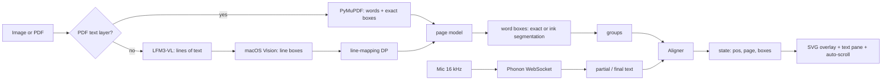

# ReadAlong — how it works

A detailed reference for the POC and for porting it to a native Mac app.

The short version: a page is turned into a list of words with boxes; a live speech
stream is matched against that list; the cursor moves; the UI draws boxes and
scrolls.



---

## 1. What the user sees

Two pages, served by one Python process:

- `/` — the reader. The source page on the left, the transcript on the right.
  The current phrase has an amber rounded box; the next phrase has a blue box.
  Read words are dimmed; the next four words are underlined.
- `/builder` — setup. Drop an image or PDF, run OCR, correct the text, move
  between PDF pages, export a highlighted JPEG.

There are no READ/NEXT labels or arrows anymore. The boxes are the whole
language.

The reader starts and stops the microphone with the button or Space. Clicking a
word jumps the cursor. `[` and `]` move one phrase back or forward. If the
reader restarts a nearby line, or skips ahead and starts a nearby line, the
highlight snaps to it without a click. When the cursor crosses a PDF page, the
image switches and the text pane scrolls.

---

## 2. Repository layout

```
readalong/
  readalong.py        one file: OCR, model, aligner, speech, HTTP server, HTML
  test_align.py       assert-based checks for the aligner and model
  requirements.txt
  README.md
  ocr.jpg             the handwritten sample
  ocr.pdf             the 4-page text PDF sample
  ocr-higlighted.jpg  the original hand-drawn style reference (unused by the app)
  data/               generated workspace (gitignored)
    current.jpg       image source, if the current document is an image
    current.pdf       PDF source, if the current document is a PDF
    pages/
      p000.jpg|png    rendered page images
      p001.png
      ...
    cache.json        version-2 document cache
    asr.log           speech server log
```

`data/` is disposable. Delete it and the app re-processes the source.

---

## 3. The data model

Everything downstream works on one JSON model. It is built by
`build_pages_model(pages)`.

```json
{
  "pages": [
    { "width": 1241, "height": 1754, "image": "p001.png" }
  ],
  "lines": [
    {
      "page": 1,
      "text": "The first 40 days after childbirth are an important period of physical and emotional",
      "box": [0.09, 0.24, 0.82, 0.02],
      "exact": true,
      "tokens": [
        { "text": "The", "norm": "the", "w": 95, "box": [0.09, 0.24, 0.02, 0.02] },
        { "text": "first", "norm": "first", "w": 96, "box": [0.12, 0.24, 0.03, 0.02] }
      ]
    }
  ],
  "words": [
    { "text": "The", "norm": "the", "page": 1, "line": 3, "box": [0.09, 0.24, 0.02, 0.02] }
  ],
  "groups": [
    { "page": 1, "start": 95, "end": 99 }
  ]
}
```

### Fields

- **page** — index into `pages`, 0-based.
- **width / height** — pixel dimensions of the rendered page image. The UI uses
  these as the SVG viewBox and multiplies normalized boxes by them.
- **image** — filename under `data/pages/`.
- **lines** — visual lines in reading order, across all pages. `line` on a word
  is an index into this global array.
- **tokens** — every whitespace-separated display token on the line. A token
  with `norm == ""` (an arrow, a lone bullet, punctuation) is display-only and
  has `w == -1`.
- **w** — index into the global `words` array, or `-1`.
- **words** — only alignable tokens. These are what the speech aligner walks.
- **groups** — contiguous ranges of word indices, 4 words or a punctuation
  boundary, whichever comes first. Groups never span a line or a page. The UI
  highlights one group amber and the next blue.
- **exact** — true when word boxes came directly from a PDF text layer. If
  false, `attach_word_boxes()` runs the ink segmenter.

### Coordinates

All boxes are `[x, y, w, h]`, normalized 0..1, **top-left origin**, relative to
the page image. Different sources are converted on the way in:

| Source | Native coordinate | Conversion |
|---|---|---|
| macOS Vision | normalized, bottom-left | `y = 1 - y - h` |
| PyMuPDF | PDF points, top-left | divide by page width/height |
| Ink segmenter | pixels, top-left | divide by image width/height |

The UI multiplies by the current page's `width`/`height` to get SVG user units.
The export multiplies by the page image's pixel size.

### Why a global word index

The aligner, the state, click-to-jump, and the keyboard shortcuts all speak one
language: `pos` is an index into `model["words"]`. Pages and lines are metadata
on those words. Moving to a different page is just `pos` crossing a boundary;
the UI reads the group's `page` and swaps the image.

---

## 4. Document ingestion

`process_source(path)` chooses one of two paths.

### 4.1 PDF with a text layer (the fast path)

`pdf_pages(path)`:

1. Open with PyMuPDF.
2. For each page, render a PNG at **150 DPI** (`page.get_pixmap(dpi=150)`). An
   A4 page becomes about 1241×1754 px.
3. Read `page.get_text("words")`. Each entry is
   `(x0, y0, x1, y1, text, block_no, line_no, word_no)` in PDF points.
4. Group words by `(block, line)`.
5. Merge lines that sit on the same baseline (`|Δy| < 3` points) and are close
   horizontally (`gap < 25` points). Some PDFs put each word in its own block
   (a list item), and without this merge a single visual line becomes ten lines.
6. Sort each line's words by x, join with spaces, and union the boxes.
7. Drop a bare page number in the bottom 10% of the page.
8. Normalize the line box and every word box by the PDF page's point size.

The result is `[{text, box, word_boxes}]` per page. `build_pages_model` assigns
`word_boxes` directly to the tokens and marks the line `exact: true`.

**Measured:** the 4-page `ocr.pdf` processes in **~0.4 s** with no OCR model and
no Vision call.

**Native Mac equivalent:** PDFKit. `PDFPage.string` gives the text; split it into
words and use `PDFPage.selection(for: NSRange)` or
`PDFPage.characterBounds(at:)` to get the rects. Render with
`PDFPage.draw(with:to:)` or use a `PDFView`.

### 4.2 Image or scanned PDF (the OCR path)

`image_pages(path)` copies the image to `data/pages/p000.jpg`, then calls
`run_ocr(path)`. `pdf_pages` calls `run_ocr(img)` for a page whose text layer has
fewer than 10 words.

`run_ocr` has two independent halves:

#### A. Text — LFM3-VL

`ocr_lfm3(path)` loads `LiquidAI/LFM3-VL-2B-MLX-4bit` through `mlx-vlm`
(0.7.11 or newer, per the model card) and asks:

> Transcribe every line of handwritten text in this image exactly as written, in
> reading order, one line of output per line of handwriting. Preserve the
> original spelling, punctuation, arrows, capitalization and line breaks. Faint
> text showing through from the back of the page is not part of this page:
> ignore it. Do not guess: write [illegible] for a word you cannot read. Output
> only the transcription, with no commentary and no markdown.

Sampling: `temperature=0.1`, `top_p=1.0`, `top_k=50`, `min_p=0.0`,
`repetition_penalty=1.1`, `max_tokens=2048`, **thinking off**. Thinking produced
the same text and no speed benefit.

The model is deleted and the MLX cache cleared immediately after the call, so it
does not compete with the speech server.

If LFM3 fails and Vision produced lines, the app falls back to Vision's text.
If both fail, the OCR error is shown in the builder.

**Measured:** 1.59 GB weights, ~4.7 s load when cached, **35–46 s** for the
handwritten sample on an M1 Pro. Accuracy was about 90% of words; the builder's
text editor is the correction path.

#### B. Line geometry — macOS Vision

`vision_lines(path)` runs `VNRecognizeTextRequest` through PyObjC, first at
`.accurate`, then at `.fast` if accurate throws. It returns every observation
with its text, confidence, and normalized bottom-left box.

`usable_lines()` keeps observations that:

- are not in the bottom 8% of the page (`y >= 0.08`),
- are line-sized (`0.008 <= h <= 0.09`),
- are wide enough (`w >= 0.12`) — this drops small diagram labels,
- have confidence `>= 0.3`,
- contain at least two alphanumerics.

It sorts them top-to-bottom.

> **Known macOS issue:** the accurate Vision model occasionally fails with
> `CRImageReaderError.e5rtError(...)`. The fast model still returns boxes but its
> text on cursive is gibberish. The app retries fast for geometry; the OCR text
> still comes from LFM3. A reboot usually restores the accurate model. PDFs are
> unaffected.

#### C. Mapping OCR lines to Vision boxes

`map_lines(ocr_lines, vlines)` does a **monotonic sequence alignment**, not a
greedy best match. Greedy matching let one bad OCR line (a diagram label) steal
a box and shift every line after it.

- `sim[i][j]` = `difflib.SequenceMatcher` ratio of normalized texts.
- Match score = `sim - 0.20` if `sim >= 0.35`, otherwise `-1.0`.
- Skipping either sequence costs `0.15`.
- Traceback pairs each OCR line with at most one Vision line, in order.
- Unmatched OCR lines keep `box: None`; their text still appears, but they have
  no image highlight.

This is what drops the "heart → Agent Turn" diagram line while keeping the 13
real lines aligned.

### 4.3 Word boxes from ink

For any line without exact PDF boxes, `attach_word_boxes()` runs
`segment_line()` on the grayscale page image.

1. Crop the line box.
2. Ink mask: `pixel < 140` (the paper is ~190, the ink ~60–100, bleed-through
   ~170+).
3. Column projection; contiguous ink columns become **blobs**. Blobs narrower
   than 2 px are dropped; then narrower than 3 px if there are more than two.
4. Word spaces are the gaps clearly wider than the rest:
   `threshold = max(8, 0.4 * median(top K-1 gaps))`, where `K` is the number of
   words on the line.
5. Cut at every gap above the threshold. If this yields too many groups, merge
   the adjacent pair with the narrowest gap until there are `K`.
6. If it yields too few groups, the last group is split proportionally by
   character width. This handles a correction written below the end of a line
   (`30 secs` with `minutes` underneath).
7. `_text_band()` finds the densest horizontal run of ink and clips each word
   box vertically to that band plus 28% margin, so ascenders from the line below
   do not make every box tall.
8. Convert pixel boxes to normalized top-left.

Character widths used for the proportional split: narrow `i l I . , : ; ' ! |`
= 0.45, wide `m w M W` = 1.45, `f j r t` = 0.75, arrow = 1.2, everything else
1.0.

This is the heuristic part. On the handwritten sample it produced boxes like:

```
[Heartbeats] [times] [by] [default] [fires] [every] [30] [secs]
```

**Native Mac equivalent:** Vision does not expose word-level boxes. Either port
this projection code with Accelerate/vImage, or use Vision's line observations
and split them proportionally. A native app could also use `VNRecognizeTextRequest`
with `.accurate` and its line boxes, then the same ink segmenter on a
`CGImage`.

---

## 5. Speech

### 5.1 Model and server

`FermionResearch/Phonon-2.5-English`:

- 158 MB, Parakeet TDT derivative, CC-BY-4.0.
- ~4.82% average WER on the Open ASR Leaderboard's seven English sets.
- MLX on Apple Silicon; CPU on Intel/Linux/Windows.

The app runs `fermion serve phonon-2.5-en --port 8010` as a subprocess. If a
speech server is already healthy on 8010–8019, it reuses it. If the port is
taken by something else, it picks a free one.

`ensure()` polls `GET /health` until `kind == "speech"`, up to 120 s. The first
load after a reboot compiles shaders and takes 10–40 s.

### 5.2 The live WebSocket

`ws://127.0.0.1:<port>/v1/audio/stream`

1. Client sends a JSON text frame:
   `{"sample_rate": 16000, "format": "pcm_f32le"}`.
2. Client sends binary frames of raw mono PCM. Frame boundaries do not need to
   align to sample boundaries.
3. Server sends JSON text frames:
   - `{"type":"partial","text":"..."}` — the whole hypothesis for the in-flight
     phrase. Replaces the previous partial. First one after ~0.35 s, then about
     twice per second.
   - `{"type":"final","text":"...","segment":N}` — a finished segment after
     ~0.7 s of silence, or at the 30 s cap.
   - `{"type":"done","text":"..."}` — after `{"type":"end"}` or a close.
   - `{"type":"error","message":"..."}`.
4. One live stream at a time. A second gets an error and close code 1013.
5. 90 s without audio closes the stream.

### 5.3 Microphone

`sounddevice.RawInputStream`:

- 16 kHz, mono, `float32`, `blocksize=1600` (100 ms).
- The callback puts each chunk into a `queue.Queue` and computes RMS for the
  level meter.
- An asyncio task drains the queue and sends binary frames.
- The receive loop calls `App._on_text(text, final)` for partials and finals.

`_run()` owns the asyncio loop in a background thread. `stop()` closes the mic,
sets `running = False`, and schedules `ws.close()` on the loop. `shutdown()`
terminates the speech subprocess if the app spawned it.

### 5.4 Startup ordering

`main()` starts one background thread, `_startup`:

1. `app.load()` from cache, or `app.ocr_now()`.
2. Only then `app.asr.ensure()`.

The web server is already listening, so the builder and reader load immediately
and show "Reading the page…" until the model is ready. Serializing OCR and ASR
keeps peak memory down on a 16 GB machine and avoids loading two model stacks at
once.

---

## 6. Alignment

This is the heart of the app. It is pure Python with no model and no
dependencies beyond `difflib`.

### 6.1 Normalization

`norm_token`:

- NFKC normalize, lowercase.
- Strip everything except letters, digits, apostrophes; then strip apostrophes.
- Map number words to digits (`nine` → `9`, `thirty` → `30`).
- A token that normalizes to `""` (arrow, lone punctuation) is not alignable.

Both the script and the ASR text go through this.

### 6.2 Local anchor — restart or skip nearby

`Aligner._anchor()` runs first on every update. It looks for the best nearby
start for the last up-to-14 ASR words.

- Window: **±400 words** around `pos` (about a page).
- For every candidate start, greedily align the ASR words:
  - For each ASR word, look for an exact match within the next 4 script words.
  - If found, count it exact and advance past it.
  - If not, allow one fuzzy match at the current position (`_score > 0`).
- The **first ASR word must match** (exact or fuzzy); candidates that skip it are
  rejected. This kills false anchors on common words.
- Require at least **4 exact words**.
- Score: `exact - 0.6 * (phrase_length - matched) - 0.005 * |start - pos|`.
  The distance term prefers the nearest occurrence.
- Commit if `|end - pos| >= 2` and `score >= 2.0`.

The anchor is what makes this work:

- Reader restarts a line above → the phrase matches behind `pos`, the anchor
  jumps back.
- Reader skips ahead and starts a line below → the phrase matches ahead, the
  anchor jumps forward.
- Normal reading → the phrase matches at `pos`, the anchor's end is within one
  word, so it does not trigger; the DP refines.

Examples (script words `w0..w39`):

| Situation | `pos` before | ASR | `pos` after |
|---|---:|---|---:|
| Normal | 20 | `w20 w21 w22 w23` | 24 |
| Restart above | 20 | `w14 w15 w16 w17` | 18 |
| Skip below | 20 | `w30 w31 w32 w33` | 34 |
| Far jump (final) | 0 | `w25 w26 w27 w28` | 29 |

On the PDF, a partial phrase from page 1 while `pos` was on page 3 moved back
~285 words and switched the page; a phrase from page 3 moved forward ~300 words.

### 6.3 Monotonic DP — normal reading

If the anchor does not commit, the app runs a dynamic-programming alignment over
a forward window:

- `lo = max(0, pos - 3)`
- `hi = len(words)` on a final, else `min(len, pos + 32)`

Scores:

| Transition | Score |
|---|---:|
| exact word | +1.0 |
| fuzzy word (`SequenceMatcher` ratio ≥ 0.62) | +0.3 |
| substitution | −0.4 |
| skip a script word | −0.10 |
| skip an ASR word | −0.50 |

The DP finds the best end position. Then it traces back to the **last exact
match** in that path:

- A fuzzy substitution is enough to keep reading, but not enough to move the
  cursor past a word the reader may not have said yet.
- `new_pos = lo + last_exact + 1`.

Commit rules:

- `new_pos > pos` (the anchor handles backward moves).
- On a partial, at least 2 ASR words.
- Confidence `best / n >= 0.15` (partial) or `0.25` (final).
- On a partial, no jump larger than 8 words.
- On a final, a jump larger than 6 words needs at least 3 ASR words.

Confidence is displayed as a percentage. It is `best / number_of_asr_words`,
clamped to 0..1.

### 6.4 Why not embeddings?

The problem is exact word tracking against a known script. A fuzzy monotonic DP
is deterministic, runs in microseconds, and needs no model. EmbeddingGemma 2
could help with semantic re-anchoring after heavy paraphrasing, but reading a
script aloud is not paraphrasing. The anchor already covers restarts and skips.
Adding a 270M–740M embedder would cost memory and latency for no accuracy gain.

### 6.5 State after alignment

`App.state()` turns `pos` into UI state:

- `current` = `[start, end)` of the group containing `pos`.
- `next` = the following group.
- `page` = the current group's page.
- `current_boxes` = union of the current group's word boxes, per line.
- `next_boxes` = union of the next group's boxes, **only if it is on the same
  page**. When the next phrase is on the following page, the blue box is empty
  and the page turns when the cursor gets there.

`group_at()` is a linear scan over the groups (there are tens, not thousands).
`group_boxes()` unions boxes per line so a group that spans two lines gets two
rounded rectangles.

---

## 7. The HTTP API

The server is Python's `ThreadingHTTPServer` on `127.0.0.1:8765` (or the next
free port). No auth; loopback only.

### GET

| Path | Returns |
|---|---|
| `/` | reader HTML |
| `/builder` | builder HTML |
| `/image` | page 0 image (compatibility alias) |
| `/page/<i>` | page `i` image, PNG or JPEG |
| `/model` | the full document model JSON |
| `/state` | the live state JSON (polled by the UI) |
| `/export?mode=read\|proof&page=N` | JPEG download |

### POST (JSON bodies)

| Path | Body | Effect |
|---|---|---|
| `/upload` | `{"name":"x.pdf","data":"data:...;base64,..."}` | save source, clear cache/pages |
| `/ocr` | `{}` | process the source; returns the model or an error |
| `/script` | `{"page":0,"text":"line\nline"}` | replace one page's text, rebuild, reset aligner |
| `/start` | `{}` | start the mic and WebSocket |
| `/stop` | `{}` | stop the mic and stream |
| `/jump` | `{"word":123}` | set `pos` directly |
| `/simulate` | `{"text":"...","final":true}` | feed a transcript without a mic (testing) |

### State JSON

```json
{
  "status": "idle | loading | listening | error",
  "error": "",
  "partial": "the last ASR hypothesis",
  "rms": 0.021,
  "ocr_status": "idle | running | done | error",
  "ocr_error": "",
  "model_ready": true,
  "pos": 95,
  "total": 995,
  "current": [95, 99],
  "next": [99, 103],
  "page": 1,
  "next_page": 1,
  "current_boxes": [[0.09, 0.24, 0.82, 0.02]],
  "next_boxes": [[0.09, 0.27, 0.60, 0.02]],
  "confidence": 0.93
}
```

`status` is the speech state. `ocr_status` is the document-processing state.
`model_ready` means `/model` has words.

---

## 8. The UI

### 8.1 Reader

Layout:

```
header: Start/Stop  status  mic meter  confidence  partial  Builder
left:   page image + SVG overlay
right:  full transcript, one <div> per line, one <span> per token
```

- On boot, poll `/model` until `lines.length > 0`, then render every token as a
  `<span>` with `data-w` (word index, or `-1`). Clicking a span with `w >= 0`
  POSTs `/jump`.
- Poll `/state` every 120 ms. This is deliberately simple: no SSE, no WebSocket
  to the browser, no framework.
- For each span: `read` if `w < pos`; `look` if `pos <= w < pos + 4`; `cur` if
  inside `current`; `nxt` if inside `next`.
- CSS: `.cur` amber background, `.nxt` blue background, `.read` opacity 0.34,
  `.look` blue underline.
- The SVG overlay uses `viewBox="0 0 pageWidth pageHeight"`. `draw()` converts
  each normalized box to user units, adds 0.4% padding, and creates a rounded
  `<rect>` in the `curg` or `nextg` group.
- If `state.page` changes, set the image `src` to `/page/<page>` and the SVG
  `viewBox` to that page's dimensions. This is the automatic page turn.
- If the current group's start word changes, `scrollIntoView({block:'center'})`
  scrolls the text pane to the current phrase. That is the automatic document
  scroll. The page image always fits the viewport, so it does not need its own
  scrollbar.
- Keyboard: Space toggles start/stop; `[`/`]` jump one group back/forward.
- Page dividers (`Page 2`) appear in the text pane when there is more than one
  page.

### 8.2 Builder

- Drop zone / file input accepts images and PDFs. The browser reads the file as
  a data URL; the server decodes it and detects PDF by name, `%PDF-` magic, or
  MIME prefix.
- After upload, `Run OCR` calls `/ocr`. A text PDF is instant; an image or
  scanned PDF may take a while.
- The proof overlay draws every word box on the selected page with a thin amber
  stroke.
- Page nav (`‹ Page 1 / 4 ›`) changes the selected page. The textarea shows only
  that page's lines.
- `Save text` posts `{page, text}`. The server keeps the old line boxes by index,
  re-tokenizes, re-segments words, rebuilds the model, resets the aligner to 0,
  and writes the cache.
- `Export JPEG` downloads `/export?mode=proof&page=N`.
- `Start reading` goes to `/`.

### 8.3 Export

`export_image(app, mode, page)`:

- Open the page image as RGBA.
- Draw rounded rectangles on a transparent layer:
  - `mode=proof`: every word box on the page, thin amber.
  - `mode=read` and the requested page is the current page: current group
    amber with a translucent fill, next group blue with a translucent fill.
- Composite, convert to RGB, JPEG quality 92.
- No text, no labels, no arrows.

---

## 9. Cache and persistence

`data/cache.json`:

```json
{
  "version": 2,
  "mtime": 1760000000.0,
  "size": 63123,
  "pages": [
    { "image": "p000.png", "width": 1241, "height": 1754,
      "lines": [ { "text": "...", "box": [...], "word_boxes": [...] } ] }
  ]
}
```

- The cache is valid when the source's mtime and size match and every page image
  exists.
- Version 1 (single image, `lines` + `width`/`height`) is migrated on load by
  copying `current.jpg` to `pages/p000.jpg`.
- `set_script` writes the cache after editing.
- `upload` deletes the cache and clears `pages/`.
- Page images are always regenerated by `process_source`; they are not trusted
  independently.

---

## 10. Performance

Measured on the M1 Pro / 16 GB used for the POC:

| Operation | Time |
|---|---:|
| PDF text extraction, 4 pages | ~0.4 s |
| PDF page render, 150 DPI | included above |
| LFM3-VL load (cached weights) | ~4.7 s |
| LFM3-VL OCR, handwritten page | 35–46 s |
| Phonon first load after reboot | 10–40 s |
| Phonon decode, 30.5 s audio | ~9 s after warmup |
| ASR partial cadence | ~0.5 s |
| ASR final after silence | ~0.7 s |
| UI poll | 120 ms |
| Highlight lag behind speech | ~0.5–1 s |

Model sizes: LFM3-VL 4-bit **1.59 GB**, Phonon-2.5 English **158 MB**. Peak
memory is lower because OCR and ASR are serialized at startup and the OCR model
is freed immediately.

---

## 11. Failure modes

| Failure | Behaviour |
|---|---|
| Vision accurate model throws `e5rtError` | retry `.fast`; boxes may be poor; text still from LFM3; reboot restores accurate |
| LFM3 fails | fall back to Vision text; boxes still from Vision lines |
| PDF has no text layer | render page, run OCR |
| `fermion` not installed | `/start` shows the install hint |
| Speech server exits | `/start` error includes the tail of `asr.log` |
| Microphone denied | error names System Settings → Privacy & Security → Microphone |
| Second live stream | server returns `engine busy`; app shows the error |
| Port 8010 taken | tries 8011–8019, then a free port |
| Port 8765 taken | tries 8766–8775 |
| Cache stale / page missing | re-process the source |
| OCR model download slow | builder shows "Reading the file…"; first run only |
| App killed | SIGTERM handler stops the server and the speech subprocess |

---

## 12. Porting to a Mac app

There are three realistic shapes. Pick based on how much native code you want to
own.

### Option A — SwiftUI front end, keep the Python brain (fastest)

Ship the current Python process as a helper and replace the browser with
SwiftUI.

```
SwiftUI app
  ├─ HTTP/WebSocket client → localhost:8765 (the Python process)
  ├─ AVAudioEngine? No: the Python process still owns the mic
  └─ UI: PDFKit/Image + overlay, transcript, controls
```

Pros: every behaviour in this document is already implemented; you only rewrite
the UI. Cons: bundling Python + MLX + torch + fermion is large and painful to
sign/notarize; the helper must run outside the App Sandbox or as a signed XPC
service. This is a good intermediate step, not the final distributed app.

### Option B — fully native (best product)

| POC piece | Native replacement |
|---|---|
| `pdf_pages` / `pdf_lines` | PDFKit: `PDFDocument`, `PDFPage.string`, `PDFPage.selection(for:)` / `characterBounds(at:)`, `PDFPage.draw(with:to:)` |
| `vision_lines` | Vision `VNRecognizeTextRequest` (line boxes) |
| `ocr_lfm3` | MLX Swift VLM, or a Core ML conversion, or a small native OCR model. LFM3-VL Swift support may lag; validate before committing. |
| `segment_line` | port the projection/blob algorithm with Accelerate/vImage; or split Vision line boxes proportionally |
| `Phonon` + `fermion serve` | `FermionResearch/Phonon-2-CoreML` (Neural Engine) + `AVAudioEngine`, if its streaming API fits; otherwise port a streaming Parakeet/Whisper Core ML model |
| `sounddevice` | `AVAudioEngine.inputNode.installTap`, `AVAudioConverter` to 16 kHz mono float32 |
| `websockets` client | `URLSessionWebSocketTask` |
| `Aligner` | pure Swift port; no dependencies; port `test_align.py` to XCTest |
| `build_pages_model` | `Codable` structs: `Page`, `Line`, `Token`, `Word`, `Group` |
| `App` / `Handler` | `@MainActor` `ReaderViewModel` + `actor DocumentStore` + `actor SpeechEngine` |
| polling `/state` | `AsyncStream<ReaderState>` from the view model |
| HTML/SVG overlay | SwiftUI `Canvas` or `Path` over the page image; or an `NSView` with `CALayer`s |
| text pane | `NSTextView` via `NSViewRepresentable` for long documents; `AttributedString` for short ones |
| auto-scroll | `ScrollViewReader.scrollTo(id, anchor: .center)` or `NSTextView.scrollRangeToVisible` |
| export | `NSImage`/`CGContext` rounded rects → `NSBitmapImageRep` JPEG |
| cache | `FileManager` Application Support/ReadAlong; same JSON schema |
| model download | `URLSession` + `Progress`, checksum, Application Support |

**Threading model**

- `@MainActor` for all UI state.
- `actor AlignerActor` owns `pos`, `words`, `conf`; `update(text:final:)` is a
  synchronous pure function inside the actor.
- `actor SpeechEngine` owns the audio engine and the WebSocket; yields
  `AsyncStream<SpeechEvent>` (`.partial`, `.final`, `.status`).
- OCR runs in a `Task.detached` / background actor; never on the main actor.
- Audio tap callbacks are real-time: copy into a ring buffer, do no allocation
  or locking on the audio thread; a consumer task drains it.

**Permissions and distribution**

- `NSMicrophoneUsageDescription` in Info.plist.
- App Sandbox: `com.apple.security.device.audio-input`. Localhost networking in a
  sandboxed app needs `com.apple.security.network.client` (and server if the app
  listens). If you keep a Python helper, prefer XPC or a Unix socket; a
  localhost HTTP server inside a sandbox is possible but adds entitlement and
  firewall friction.
- Hardened runtime + notarization. MLX/Metal shaders and any bundled Python
  runtime/dylibs must be signed. This is the main reason to go fully native.
- Model licenses: LFM3-VL is LFM Open License v1.0; Phonon-2.5 English weights
  are CC-BY-4.0. Keep the notices.

**First-run experience**

- Show a setup screen: "Download speech model (158 MB)" and "Download OCR model
  (1.6 GB)" with progress. Do not block the app on both.
- A text-layer PDF should work with only the speech model; the OCR model is
  needed only for images/scanned PDFs. Mirror the POC's lazy loading.
- Store models under `~/Library/Application Support/ReadAlong/models/`; verify
  checksums; allow deletion.

**Alignment port**

Port `Aligner` exactly. It is about 120 lines of Swift and the only non-obvious
logic in the app. Use `String.folding`/`lowercased` and a small normalizer; for
fuzzy matching use `CollectionDifference` or a tiny Levenshtein ratio. Keep the
same constants:

- anchor ±400, min 4 exact, first-word rule, score `exact - 0.6*(n-matched) -
  0.005*distance`, commit at 2.0.
- DP skip script 0.10, skip ASR 0.50, fuzzy 0.3, exact 1.0, substitution -0.4.
- last-exact traceback, forward-only commit, partial/final thresholds.

Port `test_align.py` first. If those tests pass, the rest of the app can be
rewritten with confidence.

**PDFKit caveat**

`PDFPage.selection(for:)` gives bounds in page coordinates, but word ranges from
`page.string` include whitespace and newlines. Split on whitespace, map each
word's `NSRange` to a selection, and union the selection bounds. For pages that
put each word in its own text block (like the sample's "Setting:" line), merge
lines on the same baseline exactly as `pdf_lines` does.

**Vision caveat**

Vision gives line observations, not word boxes. For printed images you can use
Vision's text directly; for handwriting you still need a VLM and the ink
segmenter. Budget time for the handwriting path; it is the least reliable part.

**ASR caveat**

Phonon is a Python package. A native app needs either:

1. `Phonon-2-CoreML` (check its streaming support), or
2. a Core ML/MLX port of a streaming Parakeet/Whisper model, or
3. a bundled helper process.

Test partial cadence and finalisation behaviour before designing the UI around
it. The POC's aligner assumes partials every ~0.5 s and finals after ~0.7 s of
silence.

### Option C — hybrid (pragmatic middle)

SwiftUI UI + a small signed XPC/LaunchAgent helper that runs the existing Python
OCR/ASR and exposes the same JSON/WebSocket API. You get a native feel and keep
the battle-tested pipeline, but you still own Python packaging. Good for an
internal or personal app; Option B is the long-term distribution path.

### Suggested migration order

1. Port `Aligner` and `test_align.py` to Swift. No UI.
2. Port the data model and cache (`Codable`, same JSON).
3. PDFKit ingestion + PDF page rendering + overlay.
4. `AVAudioEngine` → a mock WebSocket → the aligner → overlay. Prove the loop
   with a recorded WAV before touching a real model.
5. Swap in the native ASR (Core ML/MLX) or a helper.
6. Add image OCR (Vision + VLM + ink segmenter).
7. Builder/editing/export.
8. Permissions, model download, signing, notarization, first-run.

---

## 13. Code map

`readalong.py` sections:

| Section | Functions |
|---|---|
| text model | `norm_token`, `norm_text`, `tokenize`, `build_pages_model`, `build_model`, `group_at`, `group_boxes` |
| alignment | `Aligner._score`, `Aligner._anchor`, `Aligner.update` |
| OCR / boxes | `vision_lines`, `usable_lines`, `map_lines`, `clean_ocr`, `ocr_lfm3`, `run_ocr`, `_char_width`, `segment_line`, `_boxes`, `_text_band`, `attach_word_boxes` |
| documents | `clear_pages`, `pdf_lines`, `pdf_pages`, `image_pages`, `process_source`, `save_cache`, `load_cache` |
| speech | `ASR` (`ensure`, `start`, `_open_mic`, `_run`, `_session`, `_send`, `stop`, `shutdown`), `tail` |
| app | `App` (`load`, `ocr_now`, `state`, `start`, `_start_bg`, `stop`, `jump`, `set_script`, `upload`, `shutdown`) |
| export | `export_image` |
| web | `Handler` (`do_GET`, `_serve_page`, `do_POST`), `READER_HTML`, `BUILDER_HTML` |
| startup | `main`, `_sigterm`, `_startup`, `_ensure_asr` |

`test_align.py` covers normalization, exact/substitution/skip/repeat alignment,
partial revisions, noise, far jumps, nearby restarts/skips, groups, box unions,
and page metadata.

---

## 14. Glossary

- **page model** — the JSON object with pages, lines, words, groups.
- **token** — a whitespace-separated display token; may be punctuation-only.
- **word** — an alignable token (has a non-empty normalized form).
- **group** — 4 words or a punctuation boundary; the unit of amber/blue
  highlighting.
- **box** — normalized `[x, y, w, h]`, top-left origin, relative to one page.
- **exact** — word boxes came from a PDF text layer, not ink segmentation.
- **partial** — the ASR's current hypothesis for the in-flight phrase.
- **final** — an ASR segment finalized after silence.
- **anchor** — the nearby restart/skip search over ±400 words.
- **DP** — the monotonic dynamic-programming alignment for normal reading.
- **pos** — index of the next unread word in the global word list.
- **workspace** — `data/`: one source (`current.jpg` or `current.pdf`), rendered
  pages, and the cache.

---

## 15. What is deliberately not in the POC

- No cloud APIs, no telemetry, no accounts.
- No per-word boxes on handwritten images (line boxes + ink segmentation only).
- No manual box dragging; correct the text and the line is re-cut.
- No multi-column PDF layout analysis; lines are grouped by baseline and x.
- No zip export of all PDF pages; export is one page at a time.
- No embedding-based semantic re-anchoring; the fuzzy DP + anchor is enough for
  reading aloud.
- No native Mac UI yet; the browser is the POC's UI.
